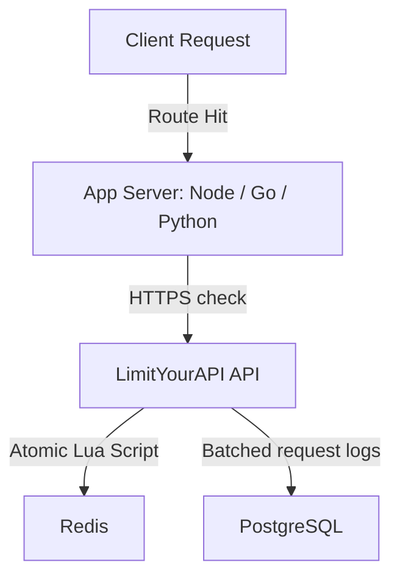

<div align="center">
  
  <h1>LimitYourAPI</h1>
  <p><strong>Hosted API rate limiting, customer quotas and AI token limits. This repository holds integration examples.</strong></p>

  <p>
    <a href="https://www.npmjs.com/package/limityourapi"></a>
    <a href="./LICENSE"></a>
    <a href="https://golang.org"></a>
    <a href="https://react.dev"></a>
  </p>

  <h4>
    <a href="https://limityourapi.tech">Website</a>
    <span> · </span>
    <a href="https://limityourapi.tech/docs">Documentation</a>
    <span> · </span>
    <a href="https://limityourapi.tech/pricing">Pricing</a>
    <span> · </span>
    <a href="https://limityourapi.tech/blog">Blog</a>
  </h4>
</div>

---

## 💡 What is LimitYourAPI?

**LimitYourAPI** is a hosted API rate limiting service. Your server asks it whether to serve a request; it runs the matching rule as one atomic Redis Lua script and answers allow or 429. It also handles customer quotas that follow Stripe and Razorpay plans, AI token budgets and IP block lists. No latency benchmarks of the hosted service have been published.

This repository contains integration examples only. The service and the SDK source are not in it.

### Why use LimitYourAPI instead of in-memory maps or API gateways?
1. **Consistency at Scale:** In-memory rate limiting fails when your application is scaled horizontally behind a load balancer. LimitYourAPI uses atomic Redis Lua scripts to maintain global consistency.
2. **Event Loop Resiliency:** Offloads CPU-intensive sliding-window computations from single-threaded runtimes (like Node.js), preventing event loop starvation.
3. **Fail-Open Design:** If the LimitYourAPI API does not answer before the SDK timeout, the SDK allows the request instead of failing it.

---

## ⚡ Architecture Overview

LimitYourAPI moves rate limit decisions out of your application and into a shared service.



### Core Architecture Highlights
* **Atomic Redis Lua Scripts:** Prevents race conditions where two concurrent requests from the same user exceed their remaining quota.
* **Batched Logs:** Request logs are buffered in memory and written to PostgreSQL in batches, off the request path.
* **Fail-Open SDK:** If the API cannot be reached before the timeout, the SDK allows the request.

---

## 🌟 Features

* **💰 Multi-Tier SaaS Quotas:** Enforce daily/monthly plan quotas per API key or user ID out of the box.
* **🛡️ Abuse Checks:** IP allow and block lists, temporary bans, IP reputation scores and adaptive limits.
* **📊 Usage Charts:** Requests, block rates and top endpoints over time.
* **🔐 Account Security:** JWT sessions in HttpOnly cookies and TOTP two-factor authentication.

---

## 📦 SDK Integrations & Installation

### 1. JavaScript / TypeScript SDK

Install the official npm package:

```bash
npm install limityourapi
```

#### TypeScript / Type-Safe Config
```typescript
import { LimitYourAPIClient, LimitYourAPIOptions } from 'limityourapi';

const config: LimitYourAPIOptions = {
  baseUrl: 'https://api.v2.limityourapi.tech',
  apiKey: process.env.LIMIT_YOUR_API_KEY || '',
  timeout: 500, // 500ms socket timeout budget
  failOpen: true
};

const limiter = new LimitYourAPIClient(config);
const decision = await limiter.check({ endpoint: '/v1/items' });
```

#### Express Middleware (JavaScript)
```javascript
import { LimitYourAPIClient } from 'limityourapi';
const limiter = new LimitYourAPIClient({
  baseUrl: 'https://api.v2.limityourapi.tech',
  apiKey: process.env.LIMIT_YOUR_API_KEY
});

app.use('/api', async (req, res, next) => {
  const result = await limiter.check({ endpoint: req.path });
  res.setHeader('X-RateLimit-Limit', result.limit);
  res.setHeader('X-RateLimit-Remaining', result.remaining);
  res.setHeader('X-RateLimit-Reset', result.resetIn);
  
  if (!result.allowed) {
    res.setHeader('Retry-After', result.retryAfter);
    return res.status(429).json({ error: 'Too Many Requests' });
  }
  next();
});
```

### 2. Python SDK

The Python SDK is not on PyPI yet, so `pip install limityourapi` does not work today. Until it is published, call the REST API (`POST https://api.v2.limityourapi.tech/enforce` with an `X-API-Key` header). This is what the client looks like:

```python
from limityourapi import LimitYourAPI

limiter = LimitYourAPI(api_key="your_api_key", timeout=2.0)
decision = limiter.check(endpoint="/profile")
```

### 3. Go SDK

The Go module is not published yet: `github.com/trynayash/limityourapi-go` does not exist, so `go get` does not work today. Until it is, call the REST API. This is what the client looks like:

```go
import "github.com/trynayash/limityourapi-go"

client := limityourapi.NewClient("your_api_key", true)
decision, err := client.Check(context.Background(), "/v1/items", nil, nil)
```

---

## 📊 Compared With an In-Memory Limiter

No latency benchmarks of the hosted service have been published. By design:

| Property | Local In-Memory | LimitYourAPI (Lua/Redis) |
| --- | --- | --- |
| **Extra network call per request** | No | Yes, one HTTPS call |
| **Shared across instances** | ❌ No | **✅ Yes** |
| **Survives restarts** | ❌ No | **✅ Yes** |
| **Change limits without a deploy** | ❌ No | **✅ Yes** |

---

## 🤝 Community & Support

* **[Contributing Guide](CONTRIBUTING.md)**: Find instructions on branching models, branch naming, and setting up local servers.
* **[Security Policy](SECURITY.md)**: Learn how to report vulnerabilities privately.
* **[Code of Conduct](CODE_OF_CONDUCT.md)**: Our expectations for community behavior.
* **[Changelog](CHANGELOG.md)**: Explore version updates.

---

## 📄 License
The examples in this repository are released under the **Apache 2.0 License**. The `limityourapi` npm package is MIT licensed.
